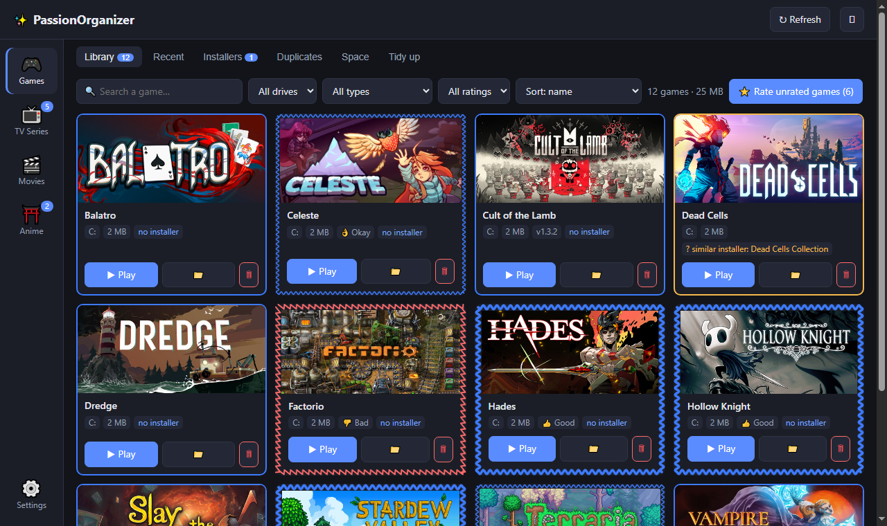
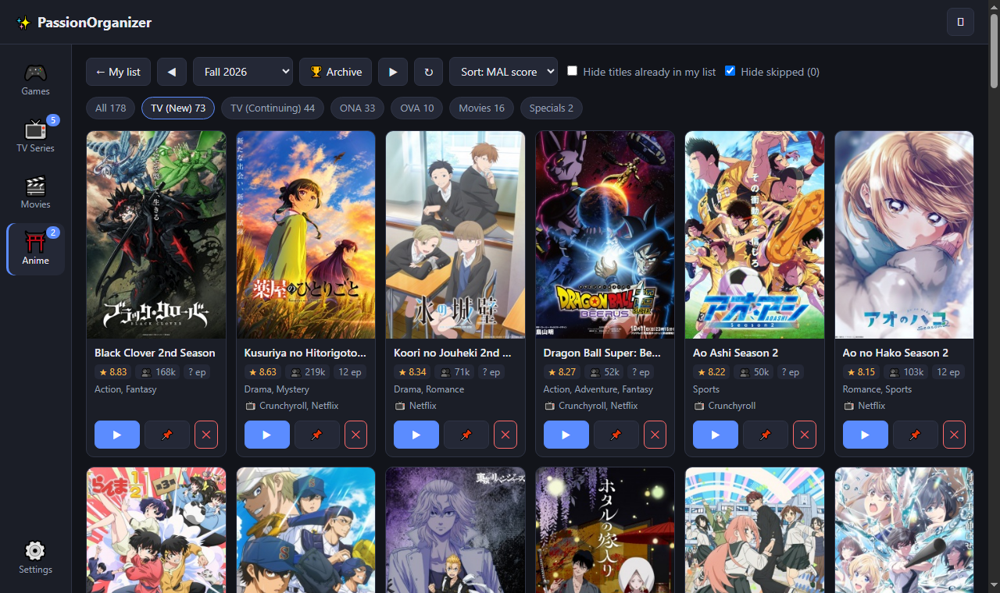
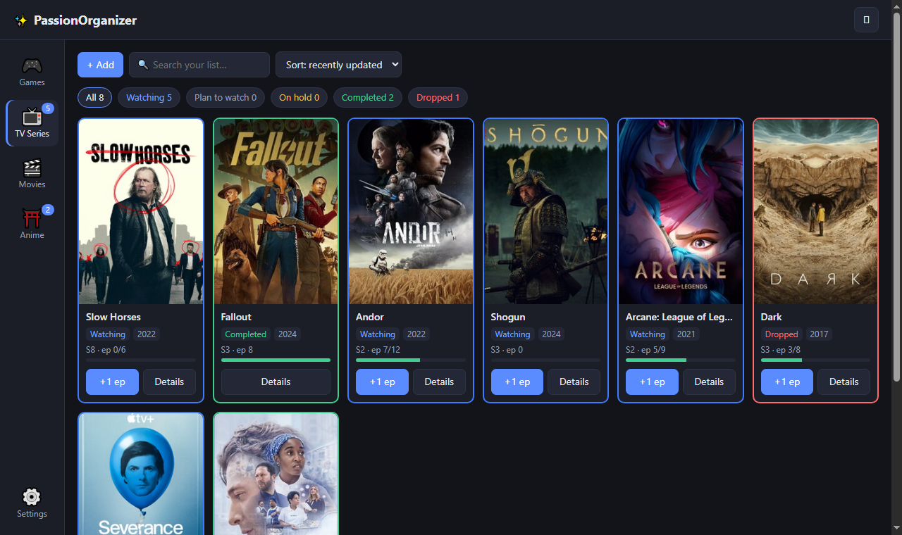
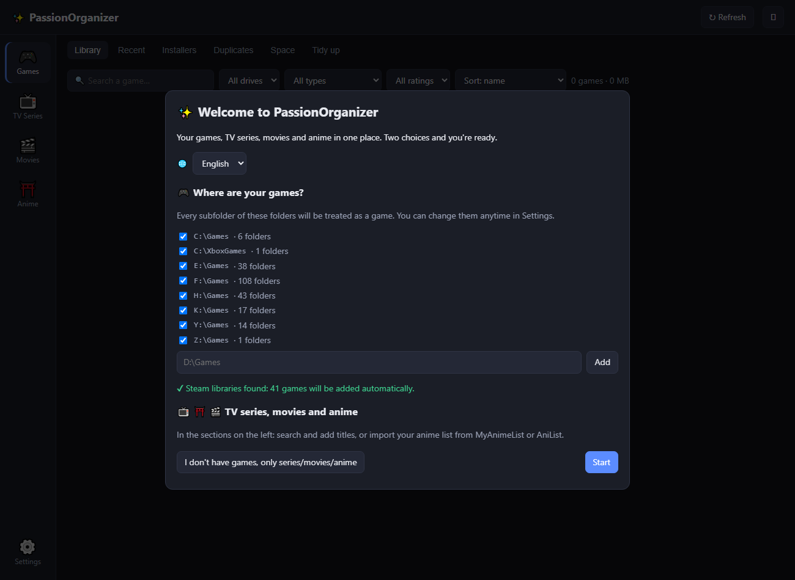

# ✨ PassionOrganizer

🇬🇧 [English](README.md) · 🇮🇹 **Italiano**

*Prima si chiamava “Gestore Giochi”.* App per Windows che riunisce in un'unica libreria tutti i giochi sparsi su più dischi (cartelle, Steam, Amazon, Riot…) e li tiene
in ordine — e tiene traccia di **serie TV, film e anime** che guardi, con un'estensione per Firefox e una pagina per il telefono.

📖 **Guida completa nella [wiki](https://github.com/Xytr4s/passion-organizer/wiki)** (in inglese).

## ⬇ Scarica

**[Scarica PassionOrganizer.exe](https://github.com/Xytr4s/passion-organizer/releases/latest)** — un solo file, niente installazione, niente Python (Windows 10/11).
Doppio clic: una breve configurazione trova le cartelle dei giochi. I dati vengono salvati in `%LOCALAPPDATA%\PassionOrganizer`.

> **"Windows ha protetto il PC"?** L'app non ha una firma digitale (i certificati sono a pagamento), quindi al primo avvio
> SmartScreen può avvisare: premi **Ulteriori informazioni → Esegui comunque**. Anche qualche antivirus può segnalare per
> prudenza i programmi creati con PyInstaller: tutto il codice sorgente è qui da controllare.

| | |
|---|---|
|  |  |
| **Giochi** — tutti i dischi in un'unica libreria; colore della cornice = installer di backup, forma = il tuo voto | **Stagioni anime** — stagione di MyAnimeList per voto: ▶ guardo, 📌 pianifico, ✕ salto |
|  |  |
| **Serie TV** — stagioni, episodi, completate / droppate all'episodio N | **Primo avvio** — lingua e cartelle dei giochi trovate in automatico |

## Sezioni (barra laterale)

| Sezione | Cosa fa |
|---|---|
| 🎮 **Giochi** | Schede: **Libreria**, **Recenti**, **Installer**, **Doppioni**, **Spazio**, **Riordina** (dettagli sotto) |
| 📺 **Serie TV** | Stagioni ed episodi visti, stati (in corso, da vedere, in pausa, completata, droppata all'episodio N), voti, note |
| 🎬 **Film** | Da vedere / Visto / Droppato, locandine dai suggerimenti di IMDb |
| ⛩️ **Anime** | Come le serie, dati da AniList |
| ⚙️ Impostazioni | Lingua, avvio con Windows, telefono, cartelle dei giochi |

### Giochi

| Scheda | Cosa fa |
|---|---|
| **Libreria** | Tutti i giochi installati con nome pulito, disco, dimensione, versione e copertina. ▶ Gioca, 📁 Apri cartella, 🗑 Elimina. |
| **Recenti** | I giochi della cartella "recenti" (es. `H:\Games\__ins`), ordinati per numero `0001_…`. |
| **Installer** | Installer e archivi (rar/zip/iso/setup), raggruppamento in cartelle `_Installer`, eliminazione in blocco. |
| **Doppioni** | Copie multiple dello stesso gioco: tiene la migliore + l'archivio più recente come backup. |
| **Spazio** | Occupazione per disco con tipo e velocità (NVMe / SSD / HDD / USB), giochi più grandi, cartelle `_DaEliminare`. |
| **Riordina** | Rinomina in blocco con nomi puliti (conserva i prefissi `0001_` / `x0001 ` / `L0001 `), annulla ultima operazione. |

Le **cornici** dicono due cose insieme: il **colore** indica se c'è un installer di backup (🟩 sì · 🟨 forse · 🟦 no),
la **forma** è il tuo voto: 👍 bello = ondulata spessa, 👌 sufficiente = ondulata, 👎 brutto = dente di sega rosso. I voti iniziali vengono
dai prefissi delle cartelle in `__ins` (`x0235 …` = bello, `L0236 …` = brutto); **⭐ Vota i giochi senza voto** mostra un gioco alla volta (tasti 1/2/3).

## Serie TV, film e anime

- **+ Aggiungi** cerca su TVmaze (serie), AniList (anime) o nei suggerimenti di IMDb (film) — senza chiavi — oppure a mano.
- **Estensione per Firefox** (`estensione-firefox/`): sui siti che scegli (riconosciuti da una parola dell'indirizzo, così funziona
  anche quando cambiano dominio) segna l'episodio o il film guardato dopo N minuti, o chiede prima. I titoli sconosciuti finiscono
  in **Da confermare**. L'episodio viene letto dal titolo della scheda (`S2E4`, `S2:E4`, `3x07`, `Stagione 4, ep. 2`…),
  dalla barra del player (es. Prime Video) o dall'indirizzo (`?season=1&episode=3`). Siti e impostazioni vengono copiati in automatico
  nell'app (e ripresi dopo una reinstallazione) e si possono esportare / importare come file dal riquadro dell'estensione.
- **Telefono**: pagina privata collegata a un tuo Foglio Google (Apps Script, gratis). Il Gestore si sincronizza ogni 5 minuti e dopo ogni modifica.
- **Stagioni anime**: 📅 **Stagione** mostra una stagione di MyAnimeList ordinata per voto MAL (con le piattaforme legali) e permette
  ▶ Guardo / 📌 Pianifico / ✕ Non mi interessa; 🏆 **Archivio** raccoglie tutte le stagioni scaricate in background (dal 2020, poi a ritroso
  fino al 1917), più le 4 stagioni in arrivo.
- **Importa la tua lista anime** da **MyAnimeList** o **AniList** (nome utente) — o da un profilo pubblico AnimeUnity — senza doppioni tra servizi.

## Sicurezza

- Ogni operazione sui file mostra prima un'**anteprima**; rinomina / sposta / "metti da parte" si possono **annullare**.
- "Metti da parte" sposta in `X:\_DaEliminare` sullo stesso disco. L'eliminazione definitiva richiede di scrivere **ELIMINA**.
- I giochi **Steam** non vengono mai spostati né cancellati dall'app. Radici dei dischi e cartelle principali sono protette.

## Avvio dal codice sorgente

Al primo avvio una **configurazione guidata** chiede la lingua e trova da sola le cartelle dei giochi (oppure scegli
"non ho giochi, solo serie/film/anime").

```
pip install -r requirements.txt
pythonw app.py            # finestra propria
python app.py --browser   # nel browser, su http://127.0.0.1:5577
```

L'interfaccia è disponibile in **italiano** e **inglese** (*Impostazioni → Lingua*).

## Struttura

| File | Ruolo |
|---|---|
| `app.py` | Server Flask + finestra pywebview, API, avvio giochi, copertine, velocità dischi |
| `scanner.py` | Scansione dischi, pulizia nomi, versioni, eseguibile principale, Steam, doppioni |
| `operazioni.py` | Anteprima / esecuzione / annullamento di rinomina, spostamento, eliminazione |
| `media.py` | Tracker di serie / film / anime, ricerca schede, riconoscimento per l'estensione |
| `sincronizza.py` | Sincronizzazione con il Foglio Google del telefono |
| `static/` | Interfaccia (`index.html`, `media.js`, `telefono.js`, `benvenuto.js`, `i18n.js`) |
| `estensione-firefox/` | Estensione per Firefox |
| `telefono/` | Script di Google Apps Script e pagina per il telefono |

Per creare tu l'`.exe`: `pip install pyinstaller`, poi `crea_exe.bat` → `dist\PassionOrganizer.exe`.

## Licenza

[MIT](LICENSE) — libero di usarlo, modificarlo e condividerlo.

File di dati locali (non nel repo): `dati.json`, `media.json`, `voti.json`, `telefono.json`, `config.json`, `copertine.json`,
`registro.json`, `eliminati.json`, `app.log`.
