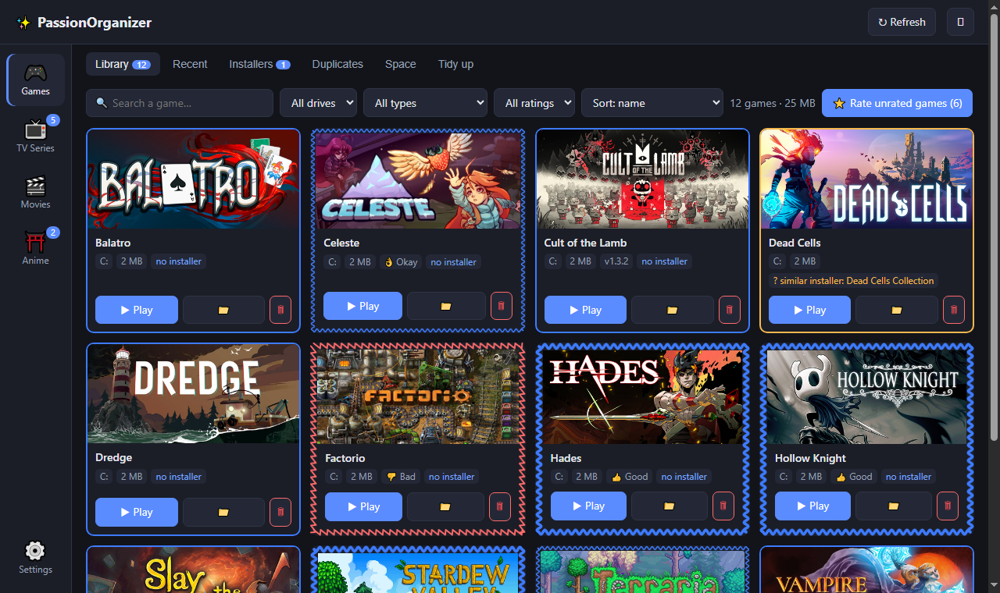
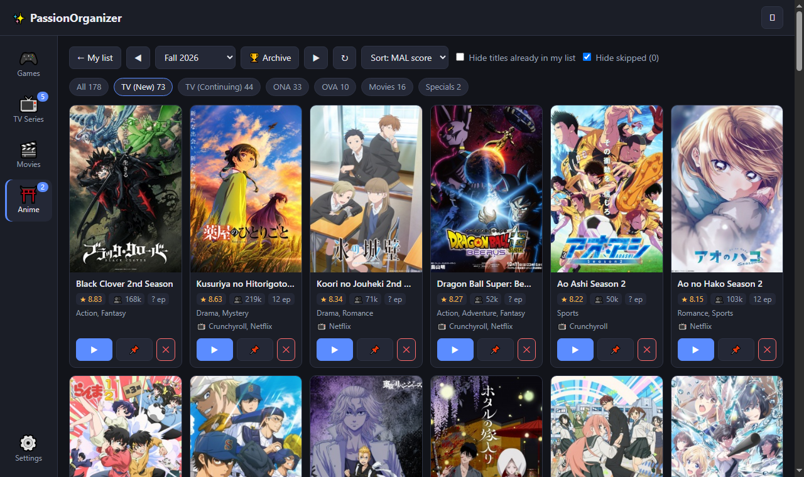
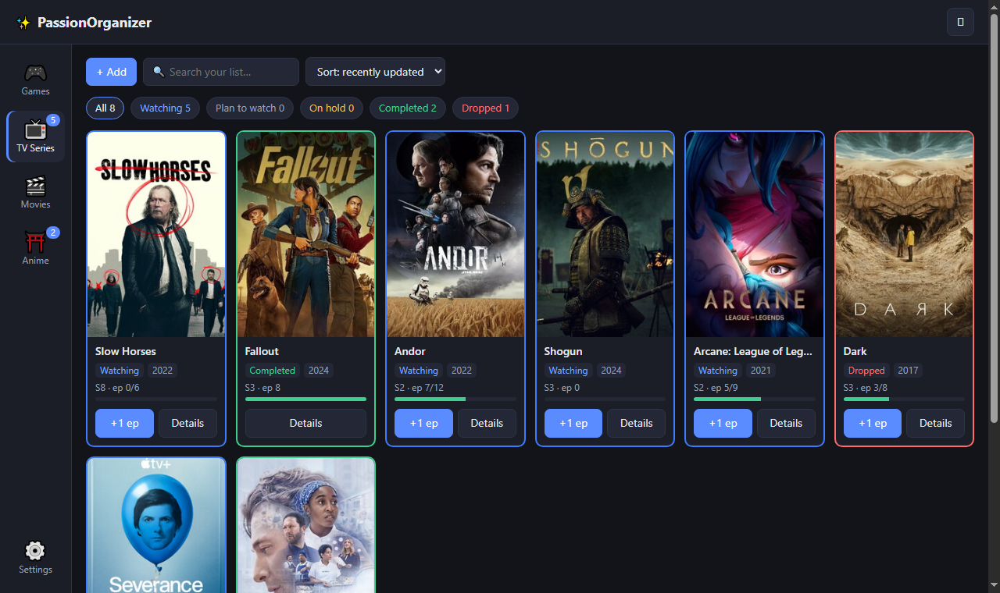
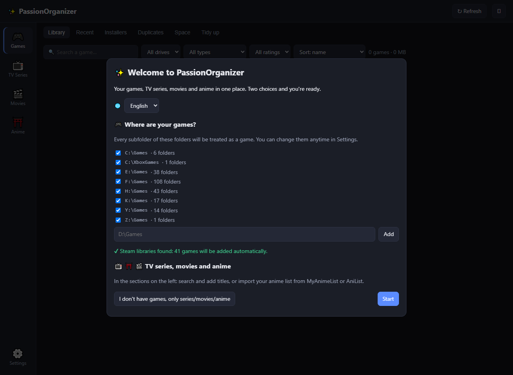

# ✨ PassionOrganizer

🇬🇧 **English** · 🇮🇹 [Italiano](README.it.md)

*Formerly “Gestore Giochi”.* A Windows app that gathers every game scattered across multiple drives (plain folders, Steam, Amazon, Riot…) into a single
library and keeps it tidy — and tracks the **TV series, movies and anime** you watch, with a Firefox extension and a phone page.

📖 **Full guide in the [wiki](https://github.com/Xytr4s/passion-organizer/wiki).**

## ⬇ Download

**[Download PassionOrganizer.exe](https://github.com/Xytr4s/passion-organizer/releases/latest)** — one file, no installation, no Python needed (Windows 10/11).
Double-click it: a short setup finds your game folders. Your data is stored in `%LOCALAPPDATA%\PassionOrganizer`.

> **"Windows protected your PC"?** The app isn't digitally signed (signing certificates are paid), so SmartScreen may warn
> on first launch: click **More info → Run anyway**. Some antivirus tools also flag apps built with PyInstaller by caution;
> the full source code is here to check.

| | |
|---|---|
|  |  |
| **Games** — every drive in one library; frame color = backup installer, shape = your rating | **Anime seasons** — MyAnimeList season by score: ▶ watch, 📌 plan, ✕ skip |
|  |  |
| **TV series** — seasons, episodes, completed / dropped at episode N | **First launch** — language and game folders found automatically |

## Sections (left sidebar)

| Section | What it does |
|---|---|
| 🎮 **Games** | Tabs: **Library**, **Recent**, **Installers**, **Duplicates**, **Space**, **Tidy up** (details below) |
| 📺 **TV Series** | Seasons and episodes watched, statuses (watching, plan to watch, on hold, completed, dropped at episode N), ratings, notes |
| 🎬 **Movies** | Plan to watch / Watched / Dropped, posters from IMDb suggestions |
| ⛩️ **Anime** | Like series, data from AniList |
| ⚙️ Settings | Language, start with Windows, phone sync, game folders |

### Games

| Tab | What it does |
|---|---|
| **Library** | Every installed game with clean name, drive, size, version and cover art. ▶ Play, 📁 Open folder, 🗑 Delete. |
| **Recent** | Games from your "recent" folder (e.g. `H:\Games\__ins`), sorted by their `0001_…` number. |
| **Installers** | Installers and archives (rar/zip/iso/setup), grouping into `_Installer` folders, bulk deletion. |
| **Duplicates** | Multiple copies of the same game: keeps the best one + the most recent archive as a backup. |
| **Space** | Usage per drive with type and speed (NVMe / SSD / HDD / USB), largest games, `_DaEliminare` folders. |
| **Tidy up** | Bulk renaming to clean names (keeps your `0001_` / `x0001 ` / `L0001 ` prefixes), undo last operation. |

**Frames** tell you two things at once: the **color** says whether an installer/backup exists (🟩 yes · 🟨 maybe · 🟦 no),
the **shape** is your rating: 👍 good = thick wavy, 👌 okay = wavy, 👎 bad = red sawtooth. Initial ratings come from the folder
prefixes in `__ins` (`x0235 …` = good, `L0236 …` = bad); **⭐ Rate unrated games** shows one game at a time (keys 1/2/3).

## TV series, movies and anime

- **+ Add** searches TVmaze (series), AniList (anime) or IMDb suggestions (movies) — no API keys needed — or add manually.
- **Firefox extension** (`estensione-firefox/`): on the sites you choose (recognized by a keyword in the address, so it keeps
  working when a site changes domain) it marks the episode or movie you watched after N minutes, or asks first.
  Unknown titles land in **To confirm**. The episode is read from the tab title (`S2E4`, `S2:E4`, `3x07`, `Season 4, Ep. 2`…),
  from the player bar (e.g. Prime Video) or from the address (`?season=1&episode=3`). Sites and settings are copied into the app
  automatically (restored on a fresh install) and can be exported / imported as a file from the popup.
- **Phone**: a private page backed by your own Google Sheet (Apps Script, free). The app syncs every 5 minutes and after every change.
- **Anime seasons**: 📅 **Season** shows a MyAnimeList season sorted by MAL score (with legal streaming platforms) and lets you pick
  ▶ Watch / 📌 Plan / ✕ Not interested; 🏆 **Archive** browses every season downloaded in the background (from 2020, then back to 1917),
  plus the next 4 upcoming seasons.
- **Import your anime list** from **MyAnimeList** or **AniList** (username) — or from a public AnimeUnity profile — with no duplicates across services.

## Safety

- Every file operation shows a **preview** first; rename / move / "set aside" can be **undone**.
- "Set aside" moves to `X:\_DaEliminare` on the same drive. Permanent deletion requires typing **ELIMINA**.
- **Steam** games are never moved or deleted by the app. Drive roots and main game folders are protected.

## Run from source

On first launch a **setup wizard** asks for the language and finds your game folders automatically (or choose
"no games, only series/movies/anime").

```
pip install -r requirements.txt
pythonw app.py            # its own window
python app.py --browser   # in the browser, at http://127.0.0.1:5577
```

The interface is available in **Italian** and **English** (*Settings → Language*).

## Structure

| File | Role |
|---|---|
| `app.py` | Flask server + pywebview window, API, game launching, cover art, drive speed |
| `scanner.py` | Drive scanning, name cleaning, versions, main executable, Steam, duplicates |
| `operazioni.py` | Preview / run / undo of rename, move, delete |
| `media.py` | Series / movies / anime tracker, metadata search, extension matching |
| `sincronizza.py` | Sync with the Google Sheet for the phone |
| `static/` | Interface (`index.html`, `media.js`, `telefono.js`, `benvenuto.js`, `i18n.js`) |
| `estensione-firefox/` | Firefox extension |
| `telefono/` | Google Apps Script and phone page |

To build the `.exe` yourself: `pip install pyinstaller`, then run `crea_exe.bat` → `dist\PassionOrganizer.exe`.

## License

[MIT](LICENSE) — free to use, modify and share.

Local data files (not in the repo): `dati.json`, `media.json`, `voti.json`, `telefono.json`, `config.json`, `copertine.json`,
`registro.json`, `eliminati.json`, `app.log`.
